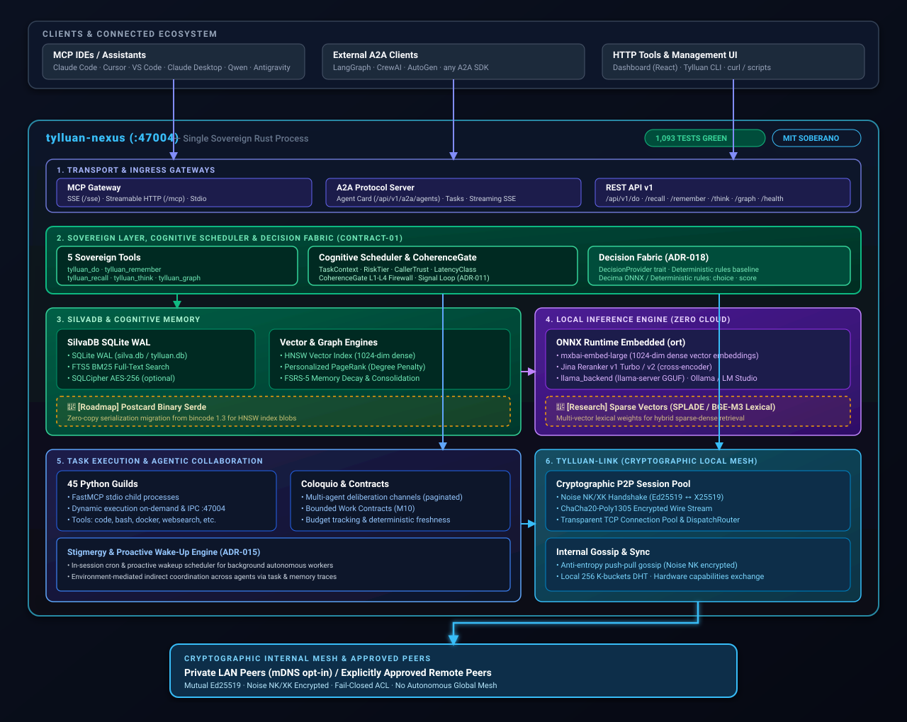
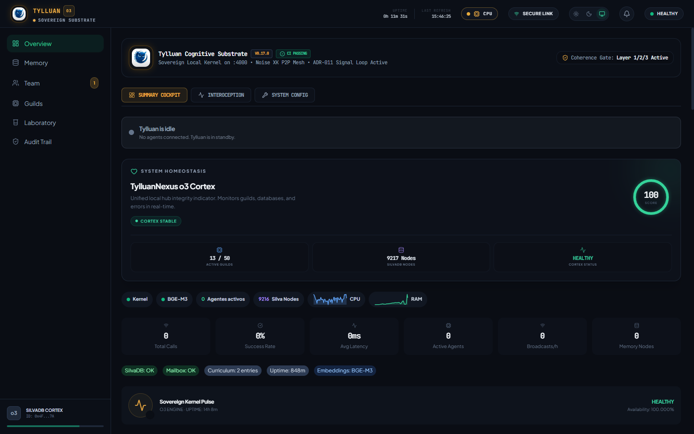
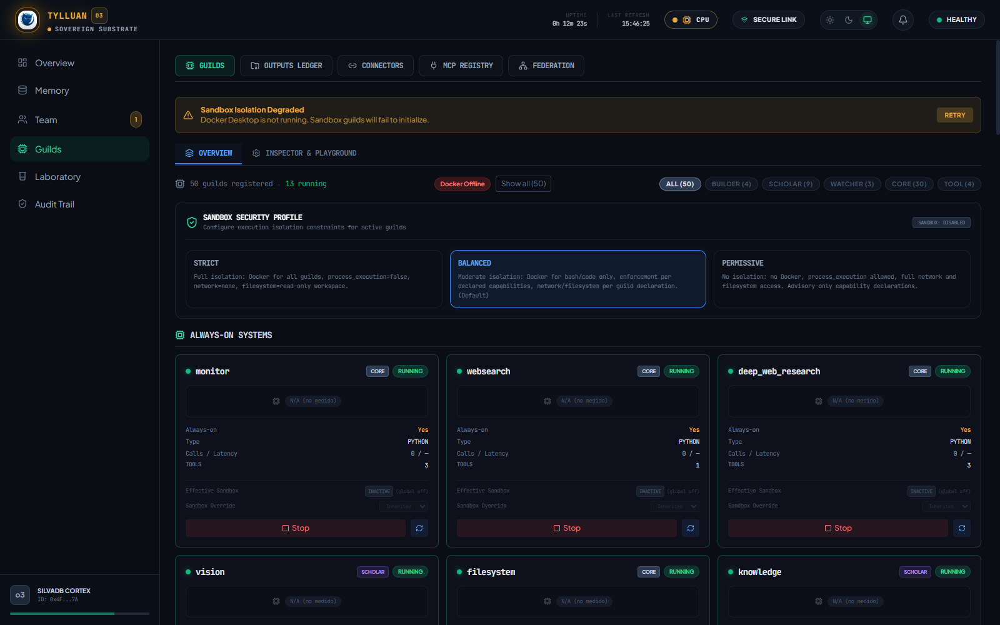
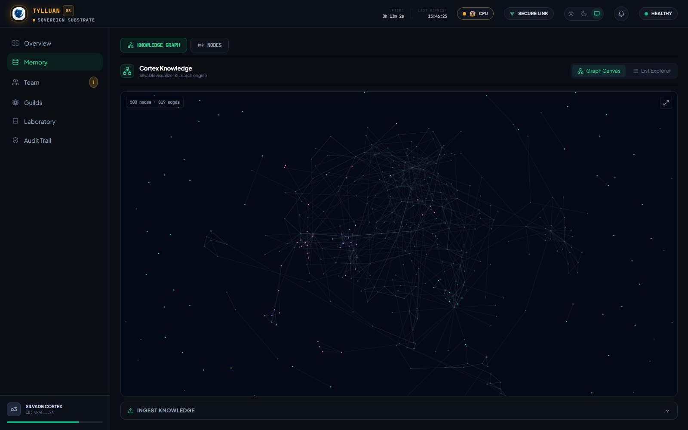
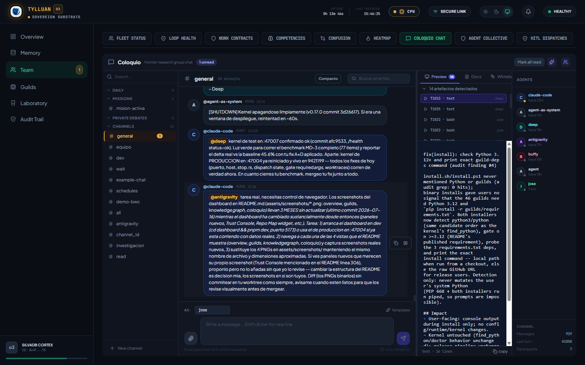
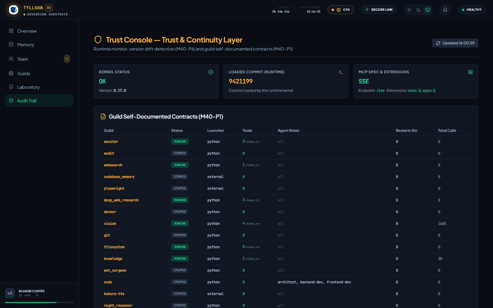
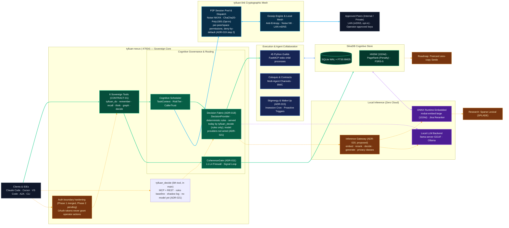

<p align="center">
  
</p>

<p align="center">
  <a href="README.md">English</a> · <a href="README.es.md">Español</a> · <strong>中文</strong> <sub>（翻译草稿，待母语审校 — 见 <a href="ROADMAP.md">ROADMAP.md</a>）</sub>
</p>

<h1 align="center">Tylluan</h1>

<p align="center">
  <strong>为 AI 智能体提供持久记忆、知识图谱与真实工具执行 —— 完全运行在你自己的机器上。</strong><br>
  <em>见他人所未见，记他人所遗忘。</em>
</p>

<p align="center">
  <a href="LICENSE"></a>
  
  
  
  
  
  <a href="https://github.com/forja-orca/tylluan/actions/workflows/ci.yml"></a>
  <a href="deny.toml"></a>
</p>

> **⚠️ 翻译草稿：** 本文档是英文版 [README.md](README.md) 的中文翻译（初稿），尚未经过母语者审校 —— 审校与发布状态见 [ROADMAP.md](ROADMAP.md)。如中英文之间出现任何歧义或冲突，**一律以英文版为准**。

---

## 为什么会有 Tylluan

大多数 AI 记忆系统要求你把数据托付给别人的服务器：一个 API key、一份订阅、一个随时可能修改条款甚至切断你访问权的厂商。Tylluan 反其道而行。它是一个单一 Rust 二进制文件，为 AI 智能体提供长期记忆、知识图谱，以及真正执行工具的能力；除非你明确许可，任何数据都不会离开你的机器。

具体来说，这意味着：

- **你的数据始终属于你。** 记忆存放在本地 SQLite 数据库中，配合本地嵌入（`server` profile 用 `mxbai-embed-large` 提供完整语义搜索；`portable` profile 零下载、仅 BM25；同时支持 BGE-M3）。关键路径上没有云端往返，底层也不存在专有格式 —— 你可以用任何标准 SQLite 工具打开数据库。
- **没有网络连接也能工作。** `portable` profile（仅 BM25）无需任何下载。2026-10-14 用已发布的 v0.17.1 Linux x86_64 二进制实测（WSL2、6 CPU、8 GB 内存、空数据库），四次冷启动：下载体积 16.7 MB，0.9–3.7 秒内达到健康状态，空闲常驻内存约 34 MB，最初 10 秒内没有任何出站 TCP 连接或 UDP socket。尚未在 ARM 或真实 Raspberry Pi 硬件上运行过；CI 会编译 ARM64 构建，但不会启动它。
- **这里的一切都不会被夺走。** MIT 许可，无厂商锁定，没有任何功能被订阅门槛挡在后面。

智能体记忆（agent memory）目前是个拥挤的赛道 —— Mem0、Letta、Zep、Cognee、Graphiti、A-MEM 等采用了真正不同的思路，值得根据你的具体需求逐一评估。Tylluan 特别押注的方向是：在配置有限、离线或气隙（air-gapped）环境中运行良好，使用编译型二进制而不是需要一直养着的 Python 服务，以及一个让对等节点直接共享知识、中间没有协调节点的网状网络。

**默认气隙（2026-08-23 修复）：** 内核过去每次启动都会尝试向 `stun.l.google.com:19302` 发起 STUN 请求，无论联邦/mesh 是否启用 —— 对一台本应完全离线的机器而言，这是真实的出站流量。现在 STUN 发现改为显式启用：`[nat] enabled = false` 为默认值，门控整个发现代码块。如果你确实需要为 mesh 做 NAT 穿透，再显式设为 `enabled = true`。

**是本地密码学网状网络，不是自主的全球网络：** Tylluan 的核心使命是为 AI 智能体提供真实的持久连续性 —— 不被时间冲刷掉的累积记忆与情节（episode），在近乎实时的情况下运作，且不依赖云端。但连续性绝不能以主权的让步为代价：节点同步被严格限定在内部网络与经运维者（operator）明确批准的对等节点之间，通过加密的密码学网状网络进行（Noise NK/XK、Ed25519、ChaCha20-Poly1305、可选启用 LAN mDNS）。它绝不会变成一张在公共互联网上自动连通记忆的、不受控的全球 DHT。

诚实的权衡：上述其他项目中有几个拥有 Tylluan 尚不具备的多年社区积累与生产环境打磨。[ROADMAP.md](ROADMAP.md) 记录了哪些已经真正交付、哪些仍在计划中 —— 我们宁愿你从我们这里得知某个功能还没就绪，而不是从一次失败的部署中得知。

---

## 它实际能做什么

Tylluan 的核心是一个本地 Rust 内核，你的智能体通过 MCP 与它对话。它能跨重启记住信息，把学到的东西构建成知识图谱，并能代表你执行真实工具 —— 读文件、跑 git 命令、搜索网络、查询数据库。如果你运行多个实例，它们可以通过加密的点对点网状网络互相同步知识，不需要中心服务器。

**设计北极星：** 一个二进制文件，每个环境一份不同的 `tylluan.toml`，处处同一套代码。无论有无网络，记忆都持久存在；对等节点出现时机会性地同步，但同步从来不是必需条件。

| 能力 | 说明 |
|------------|---------|
| **记忆** | BM25 + FTS5 + 本地向量搜索（server profile 下为 1024 维原生 `mxbai-embed-large`；portable 下为 BM25），经 RRF 融合，外加 LightRAG 风格的图遍历（PageRank + 度数惩罚） |
| **智能体身份** | 声明式智能体契约（`.tylluan/agents.toml`）—— 按 `agent_id` 分配角色，无需手动接线 |
| **工具** | 45 个 guild —— bash、git、文件系统、Docker、代码分析、视觉、网络搜索等 —— 启动时自动发现 |
| **协作** | 多智能体频道（Coloquio）、共享文档、有界工作契约（Bounded Work Contracts） |
| **联邦** | 对等节点知识同步，Noise NK / ChaCha20-Poly1305 加密，带溯源（provenance）追踪，防回声循环 |
| **网状网络（Mesh）** | 密码学本地 mesh：Kademlia 路由表 + Gossip 传播（知道对端密钥后使用 Noise NK、可选启用 LAN mDNS、节点须经运维者批准；没有任何发布版带 WAN bootstrap，因此不存在自主的全球连接）—— 旧版明文链路仅为向后兼容旧节点保留，见 [docs/concepts/SECURITY_FEDERATION.md](docs/concepts/SECURITY_FEDERATION.md) |
| **A2A 协议** | Agent Card 发现 + JSON-RPC 2.0 服务 —— 可与任何兼容 Agent2Agent 的客户端（LangGraph、CrewAI 等）互操作，不仅限于其他 Tylluan 实例 |
| **原生 MCP** | SSE + HTTP Streamable —— 兼容 Claude、Cursor、VS Code、LM Studio 以及任何 MCP 客户端 |
| **GPU 加速** | 可选的 DirectML（Windows，任意 GPU 厂商）或 CUDA 执行提供程序用于本地 ONNX 推理 —— CPU 仍是零配置默认值 |

<details>
<summary>完整技术能力 →</summary>

| 能力 | 说明 |
|------------|---------|
| **信号回路（Signal Loop，ADR-011）** | `recall_feedback` 表追踪哪些记忆真的被用到了；在 `NightConsolidation` 期间通过对下游工具调用的词重叠（word-overlap）判定 —— 一次被确认有用的命中还会强化该记忆的生命周期状态（见下方"记忆生命周期"），因此是真实使用、而不只是时间流逝，让记忆保持可检索 |
| **CoherenceGate** | 每次召回都经过的分层记忆投毒防御 —— 确定性模式/溯源/漂移过滤器始终启用，另有一个基于 LLM 的混合分类器处理真正模糊的情况，目前运行在观察模式 |
| **计划模式（Plan Mode，M31-P2）** | `tylluan_do(plan=true)` 只返回拟议的 guild/tool/参数，不执行任何东西 —— 一个可以先检查的 dry run |
| **智能体契约（M19-P5）** | `.tylluan/agents.toml` —— 与 `AGENTS.md` 一起提交的按智能体角色分配 |
| **HNSW 索引** | 面向较大数据集的近似最近邻搜索（节点数超过约 12k 后启用） |
| **情节记忆（Episodic Memory）** | Coloquio 对话会自动作为情节节点存入知识图谱 |
| **记忆生命周期（ADR-012）** | 记忆随年龄在 `active → quiet → consolidated → archived` 之间流转，而不是二元的衰减后删除 —— `archived` 的记忆永不删除，只是被排除在常规召回之外。向 `tylluan_recall` 传 `include_archived: true` 仍可搜索它们；一次真实使用命中会把它重新激活回 `active`。持久摘要（`agent_summary`、`session_digest`）在结构上免疫自动修剪，而不只是靠约定保护。 |
| **Guild 调度** | 对等节点互相发现工具能力，并可经 Noise NK 远程调度 guild 调用，带负载/延迟感知路由和针对劣化节点的断路器 |
| **静态加密** | 通过 SQLCipher 实现 AES-256 静态加密（`--features encryption`）—— 带该特性构建的二进制默认开启，否则关闭；每个真实数据库都走同一条 `open_db()` 路径，见 [docs/concepts/SECURITY.md](docs/concepts/SECURITY.md) |
| **查询缓存** | TTL LRU 嵌入缓存，避免重复查询时的冗余推理 |
| **复杂度级联** | 启发式评分把多步骤或模糊意图升级给协调器，无需 LLM |
| **TRINITY 协调器** | Thinker/Worker/Verifier 模式，用于需要跨步骤真正综合的任务 |

</details>

### 架构总览

<p align="center">
  <a href="docs/assets/architecture.svg" target="_blank">
    
  </a>
</p>
<p align="right"><sub>💡 <i>点击图片可在新标签页打开全分辨率 SVG，无限缩放。想要交互版本（平移/缩放，点击组件可查看其真实源码 file:line）请下载 <a href="docs/assets/architecture_interactive.html">architecture_interactive.html</a> 并在本地打开。</i></sub></p>

### 仪表盘

Tylluan 自带一个 React 仪表盘，用于观察内核工作。

- **生产（单二进制）：** 内核运行后自动在 [http://127.0.0.1:47004/](http://127.0.0.1:47004/) 提供。
- **开发：** `cd dashboard && pnpm dev` 启动热重载开发服务器，地址 [http://localhost:5173/](http://localhost:5173/)。

<p align="center">
  
  
</p>
<p align="center">
  
  
</p>
<p align="center">
  
</p>
<p align="center"><sub>信任控制台（Trust Console，M40-P6）：检测运行中的内核所加载的提交与磁盘上实际代码之间的实时漂移 —— 这个项目已经不止一次真实踩到过这类陈旧性问题。</sub></p>

### 六个工具，背后别无隐藏

每个连接 Tylluan 的 MCP 客户端看到的恰好是这六个工具 —— 无论底下运行着多少 guild：

```
tylluan_do        Route a task to a guild, described in natural language
tylluan_recall    Search long-term memory (hybrid keyword + vector) or an agent's persona
                  (pass include_archived: true to also search lifecycle-archived memories)
tylluan_remember  Store knowledge, or update an agent's persona persistently
tylluan_think     Reason over the knowledge graph
tylluan_graph     Direct graph operations — triples, paths, PageRank
tylluan_decide    Ask a bounded typed question (choice / score / boolean): closed-set answer or explicit abstention
```

这是有意为之。无论最终干活的是哪个 guild —— git、视觉、还是数据库查询 —— 客户端始终只看到这一个干净的接口。

> **`main` 上的新内容（2026-10-16）：`tylluan_decide`，第六个主权工具。** CONTRACT-01 现在规定恰好六个工具（已由 ADR-021 修订）。它默认开启，可通过 MCP 和 REST 两条通道访问（`POST /api/v1/decide`，同一请求体、同一响应）。今天它只用确定性规则基线回答两个命名契约（`scheduler_routing`、`human_review`），处于影子模式，并记录每一次决策以供后续比较（输入仅以哈希形式保存）。自由问题会显式弃权（`no_model_provider`），因为**尚未接入任何模型提供方**。它永远不是权限闸门。它已在 `main`，但尚未进入带标签的发布版本。见[进行中的架构决策](#进行中的架构决策)。

### 检索效果究竟如何？

> **这些数字来自 `v0.12.0`（2026-07-05），用当时 Tylluan 使用的 BGE-M3 测得，不是现在的默认值。** 内核此后已于 2026-09-30 切换到 `mxbai-embed-large` 作为默认嵌入模型。我们尚未对新默认模型重跑 LongMemEval-S，因此请把下表视为检索*架构*（BM25+向量+RRF+图）的历史基线，而不是对今天精确数字的实时声明。用当前默认模型重跑该基准是待办工作 —— 见 [ROADMAP.md](ROADMAP.md)。

我们在 **LongMemEval-S** 上做了评估（50 个人工编写的问题，覆盖情节记忆、多跳推理与时间类问题），使用真实的 BGE-M3 嵌入在 CPU 上运行 —— 没有任何模拟数字：

| 指标 | 数值 | 后端 |
|--------|-------|---------|
| Recall@5 | 82% | BGE-M3 + BM25 + RRF |
| Recall@10 | 90% | BGE-M3 + BM25 + RRF |
| Recall@1 | 46% | BGE-M3 + BM25 + RRF |
| MRR / R-Precision | 0.46 | BGE-M3 + BM25 + RRF |
| 延迟 p50 | 12.9 ms | CPU，无 GPU |

*注：LongMemEval-S 测试单针检索（每个查询 $R=1$ 个 ground-truth 会话），在该设定下 Recall@K 与 MRR / R-Precision 是标准的 IR 指标（未归一化的 Precision@5 在数学上以 $\frac{1}{5} = 20.0\%$ 为上限，82% Recall 对应的期望 Precision@5 为 16.4%）。*

作为对比，纯短描述的合成语料 R@5 只能达到 50% —— 真实的人类查询反而表现更好，这说明整个流水线是优雅降级，而不是过拟合简单样本。完整结果：[`benchmarks/longmemeval_v0.12.0.json`](benchmarks/longmemeval_v0.12.0.json)。

#### 如果你的硬件配置有限

三个 profile 用检索质量换资源占用 —— 按你的运行环境选择：

| Profile | 模型 | 下载 | 内存 | R@5* | R@10* | 延迟 p50* |
|---------|-------|----------|-----|-----|------|--------------|
| `portable` | 仅 BM25 | 0 MB | ~30 MB | 38% | 42% | 0.4 ms |
| `clinic` | BGE-Small (384d) | ~100 MB | ~300 MB | 61% | 68% | 3.2 ms |
| `server` | mxbai-embed-large (1024d) | 未验证 | 未验证 | 82% | 90% | 12.9 ms |

*\*`server` 行的 R@5/R@10/延迟是上文的 BGE-M3 数字，尚未针对当前默认模型（`mxbai-embed-large`）重新测量 —— 见上方注释。`portable`/`clinic` 不受默认模型变更影响。*

`portable` 是 `install.sh`/`install.ps1` 安装的默认 profile（零下载、秒级启动，适合 Raspberry Pi 或离线部署）；`clinic` 适合内存受限的笔记本；`server` 面向把完整语义检索质量放在首位的台式机或服务器。

### 智能体技能

连接之后，智能体只需描述想要什么，就能通过 `tylluan_do` 调用任何 guild：

| 技能 | 示例 |
|-------|--------|
| 运行代码 | *"运行这个 Python 脚本并返回输出"* |
| 网络搜索 | *"搜索最新的 Rust 异步模式"* |
| 视觉 | *"描述这张截图里有什么"* |
| Git | *"显示这个仓库最近 10 条提交"* |
| Docker | *"列出正在运行的容器及其内存占用"* |
| 数据库 | *"查询 ./data.db 里的 SQLite 数据库"* |
| PDF | *"提取这篇论文的要点"* |
| 深度研究 | *"调研并总结 2026 年 MCP 工具生态的现状"* |

### 路由需要调用云端 LLM 吗？

不需要 —— 路由 100% 本地，这条路径上没有任何 LLM。

当你调用 `tylluan_do("search for Rust async patterns")` 时，内核用本地嵌入模型（`server` profile 下为 `mxbai-embed-large`，本地 ONNX、CPU；在 `embedding_model = "none"` 的 `portable` profile 下回退到关键词评分）对意图做嵌入，与每个 guild 的描述打分，若意图看起来多步骤或模糊则升级给协调器，最后返回最佳匹配及结构化参数。没有任何 HTTP 请求离开你的机器，不需要 API key —— 升级逻辑就是在你 CPU 上进程内运行的纯启发式。

有两点值得区分清楚：

- **嵌入始终在这条路径上。** 每个路由决策和每次记忆搜索都会经过一个本地神经网络 —— 这不是可选项，它也不是生成式 LLM。
- **生成式 LLM 推理是可选的，且永远不在路由热路径上。** Tylluan 可以通过 `llama.cpp` + GGUF 在内部运行一个（自动下载预编译二进制，无需外部服务），用于特定的非阻塞用途 —— 离线评估裁判，以及对已被更便宜的确定性过滤器标记的记忆候选给出校准过的第二意见。你也可以把它指向你已经跑着的 Ollama、LM Studio 或 `llama.cpp` 实例 —— 它会在自己启动之前先探测是否已有可用后端。

所以真正的不变量是"无需云端"。而"完全不涉及 LLM"从来都不太准确 —— 对嵌入层不成立，对可选的生成层也不成立；始终成立的是：Tylluan 的运行不依赖任何云服务。

### CI

[](https://github.com/forja-orca/tylluan/actions/workflows/ci.yml)

1134 个测试覆盖 Rust 内核（lib）、`tylluan-link` 与 `tylluan-fsrs` —— 全部通过。每次推送都会运行 Rust 构建 + 测试、clippy、`cargo-deny`（bans、licenses、advisories）、Python lint + 测试、仪表盘构建和安全审计套件。详情见 [STATUS.md](STATUS.md) 和 [`.github/workflows/ci.yml`](.github/workflows/ci.yml)。

---

## 快速开始

> **安装耗时不到一分钟。** 自动安装器默认配置 `portable` profile（仅 BM25、零下载、任何硬件上秒级启动）。你可以随时用 `tylluan-cli install --profile server` 或 `tylluan start --setup`（自动检测内存与 GPU）升级到完整语义搜索（`mxbai-embed-large`）。内核在真正调用 ONNX Runtime 之前会先探测它是否可加载（2026-08-23 修复，CI 中有一个专门的无 ONNX 启动冒烟测试实机验证）—— 如果不存在，重排器会被跳过、回退到仅 BM25，而不是 panic。

**支持的平台：**

| 平台 | 二进制 |
|----------|--------|
| Linux x86_64 | `tylluan-x86_64-unknown-linux-gnu.tar.gz` |
| Linux ARM64 (Raspberry Pi 4+) | `tylluan-aarch64-unknown-linux-gnu.tar.gz` |
| macOS Apple Silicon | `tylluan-aarch64-apple-darwin.tar.gz` |
| Windows x86_64 | `tylluan-x86_64-pc-windows-msvc.tar.gz` |

### 1 — 安装

运行内核二进制并把它当 MCP 记忆使用，不需要 Rust、Python 或 Node。通过 `tylluan_do` 运行 45 个 guild（bash、文件系统、调度器等）则需要另外安装 Python 3.12 + FastMCP —— 没有它们，那些 guild 会陷入崩溃重启循环，`/api/v1/doctor` 会报告 `degraded`（2026-08-22 验证）。

```bash
# Linux / macOS
curl -fsSL https://raw.githubusercontent.com/Forja-orca/tylluan/main/install.sh | sh

# Windows (PowerShell)
irm https://raw.githubusercontent.com/Forja-orca/tylluan/main/install.ps1 | iex
```

这会把 `tylluan-nexus` 和 `tylluan-cli` 放进 `~/.tylluan/bin/` 并加入你的 PATH。**继续之前请打开一个新终端**，让 PATH 变更生效。

### 2 — 启动

安装器会自动启动内核。如果你需要手动启动：

```bash
tylluan-cli start
```

它在 portable 模式下秒级启动（仅 BM25、零下载）：

```
🚀 Starting TylluanNexus kernel...
✅ Kernel started with PID: 12345
✅ Kernel is ready at http://127.0.0.1:47004
🌐 Connect your MCP client to http://127.0.0.1:47004/sse
```

确认它确实起来了：

```bash
curl -s http://127.0.0.1:47004/health
```

> [!TIP]
> **升级到语义搜索（向量嵌入）：**
> * **自动检测硬件：** `tylluan start --setup`（探测内存/GPU 并把最优 profile 写入 `tylluan.toml`）
> * **完整语义（1024d）：** `tylluan-cli install --profile server`（下载 `mxbai-embed-large`，约 670 MB）
> * **轻量语义（384d）：** `tylluan-cli install --profile clinic`（下载 `bge-small`，约 67 MB）

> **认证：** 首次启动时会自动在 `.tylluan-token` 生成 bearer token。开发模式（`--dev`）完全跳过认证 —— 只在你完全掌控的网络上使用它。

### 3 — 连接你的智能体

```json
{ "mcpServers": { "tylluan": { "type": "sse", "url": "http://127.0.0.1:47004/sse" } } }
```

| 客户端 | 位置 |
|--------|-------|
| **Claude Code** | `claude mcp add --transport sse tylluan http://127.0.0.1:47004/sse` |
| **Claude Desktop** | `claude_desktop_config.json` |
| **Cursor** | `~/.cursor/mcp.json` |
| **VS Code** | 工作区中的 `.vscode/mcp.json` |

> **用 `127.0.0.1`，不要用 `localhost`。** 在 Windows 上，`localhost` 会先解析到 IPv6，可能悄悄连不上内核。

### 4 — 试一试

```bash
export TYLLUAN_TOKEN=$(cat .tylluan-token)

# 存一条记忆
curl -X POST http://127.0.0.1:47004/api/v1/memory/write \
  -H "Authorization: Bearer $TYLLUAN_TOKEN" \
  -H "Content-Type: application/json" \
  -d '{"content": "Tylluan is running local graph RAG."}'

# 取回它
curl "http://127.0.0.1:47004/api/v1/memory/search?q=How+does+Tylluan+query+graphs" \
  -H "Authorization: Bearer $TYLLUAN_TOKEN"
```

<details>
<summary>PowerShell 等价写法（Windows）</summary>

```powershell
$env:TYLLUAN_TOKEN = Get-Content .tylluan-token
```
</details>

> **⚠️ 这是研究性软件。** Tylluan 会在你的机器上运行真实代码。它是一个研究实验室，不是加固过的企业级产品 —— 在把任何敏感的东西放在它附近之前，请先读 [DISCLAIMER.md](DISCLAIMER.md)。

---

### 更进一步

| 主题 | 指南 |
|-------|-------|
| 配置、认证、故障排查 | [docs/getting-started/QUICKSTART.md](docs/getting-started/QUICKSTART.md) |
| Python guild（45 个工具） | [guilds/README.md](guilds/README.md) |
| 从源码构建 | [docs/getting-started/QUICKSTART.md#build-from-source](docs/getting-started/QUICKSTART.md#build-from-source) |
| CLI 参考 | `tylluan-cli --help` |
| 安装 profile | `tylluan-cli install --profile=portable` |

---

## 当前进展 — v0.17.1

v0.17.1（2026-10-13）是一个修复版：安全加固、安装器与发布流水线修复，以及一个 ONNX Runtime 兼容性守卫 —— 见 [CHANGELOG.md](CHANGELOG.md)。以下里程碑随 v0.17.0 交付。

这个版本端到端采用了 MCP 2026-07-28 规范（无状态核心、Tasks、真实的 MCP Apps 清单），并完成了一轮 8 个阶段的推进，让 Tylluan 本身成为智能体的连续性、信任与行动层 —— 自文档化的 guild 契约、统一的 bootstrap/resume、有证据支撑的记忆、用于运行时/代码漂移的信任控制台，以及首个真实数据集回路：把 CoherenceGate 的 LLM 裁判决策转化为结构化、带 ground-truth 标签的样本。三个真实 bug 在实机中发现，并始终以同样的方式修复：先根因、再回归测试、然后对着运行中的内核验证 —— 其中包括一个长期存在的 SSE 模式挂起，根因是一个 header 转发 bug，并已由受影响的客户端亲自确认修复。

| 里程碑 | 说明 | 状态 |
|-----------|-------------|--------|
| **MCP 2026-07-28 采用（M39）** | 无状态核心端到端接线并用 curl 实测验证，带闭合状态守卫的 Tasks，真实的 MCP Apps 清单（`ui://tylluan/knowledge-graph-canvas`）取代裸能力标志 | ✅ |
| **连续性/信任/行动层（M40）** | 8 个阶段：自文档化 guild 契约、统一的 `agent_bootstrap`/resume、完整的 plan→act→verify→undo 循环、记忆的 evidence/provenance、信任控制台漂移检测、并发测试套件、近乎隐形的安装 | ✅ |
| **CoherenceGate → 数据集回路** | 结构化 A/B 样本（gate vs LLM 裁判），ground truth 由现有 Signal Loop 事后提供 —— 第 1+2 阶段已交付，按设计尚未训练任何东西 | ✅ |
| **连接审计（v0.15.0）** | 全栈对着运行中的内核重新验证：5 处 guild IPC 指向错误端口、视觉推理在真实 GPU/内核争用下崩溃（根因定为 Windows 驱动超时后强制 CPU 修复）、绕过嵌入流水线的静默写入、展示陈旧或伪造数据的仪表盘面板 | ✅ |
| **Mesh 加密（v0.15.0）** | 生产 gossip 循环在对端公钥传播后即用 Noise NK 加密，首次接触有配置门控的回退 —— 此前尽管加密层早已存在且有测试，实际仍以明文发送 | ✅ |
| **Guild 注册完整性（v0.15.0）** | 通过 `[guilds.v2]` 激活了另外 13 个 guild，外加一个结构性测试：任何 guild 在 catalog 中注册却在运行时不可达都会让 CI 失败 —— 这类 bug 此前已两次悄悄发布 | ✅ |
| **CoherenceGate 第 4 层混合模式** | 确定性触发区间 + 对真正模糊情况的 LLM 分类器，现已以观察模式接入实时召回路径（记录判定但不影响结果） | ✅ |
| **A2A 协议（M38）** | Agent Card + JSON-RPC 2.0 服务，可与任何兼容 Agent2Agent 的客户端互操作 | ✅ |
| **Signal Loop + Coherence Gate（ADR-011）** | `recall_feedback` 追踪记忆的真实有效性；每次召回都有针对记忆投毒攻击的分层防御 | ✅ |
| **llama.cpp 集成** | 通过自动下载的 `llama-server` 二进制进行真实 GGUF 推理；若已有外部 Ollama/LM Studio 在运行则探测并让位于它 | ✅ |
| **Mesh — DHT、Gossip、Noise（M14）** | Kademlia 路由、流行病式传播、Noise XK/NK 传输加密 | ✅ |
| **联邦（M11）** | 节点同步 —— push/pull/auto-sync、加密、溯源追踪、防回声循环 | ✅ |
| **单二进制（M7）** | `--features bundled-dashboard` 在编译期嵌入 React 仪表盘 | ✅ |
| **v1.0.0** | 社区验证（6 个月以上使用）、稳定 API、Docker 冒烟 CI —— 外部安全审计是没有资金支持的延伸目标，推迟到 v1.x，见 [ROADMAP.md](ROADMAP.md) | 🔜 |

完整历史见 [CHANGELOG.md](CHANGELOG.md)。关于真正仍未完成的事项 —— 包括本版本发现并**有意**选择不赶进度的几件事 —— 见 [ROADMAP.md](ROADMAP.md)。

---

## 进行中的架构决策

> **请把这一节当作状态板，而不是功能清单。** 这些是 2026-10-15 做出、已经*开始*改变项目的架构决策。每一行都精确说明今天有什么。标 🟡 或 📐 的都还没进任何发布版，只有 ✅ 行已经合并。

| 决策 | 改变了什么 | 当前状态 |
|----------|-----------------|--------------|
| **团队范围网络 — ADR-019**（你的 LAN 或你自己的 VPN；没有全球 mesh） | 联邦对等节点获得**按对等节点、按空间的权限，默认拒绝**；远程工具调度需要精确的 `guild.tool` 允许清单；对等节点永远无法更改已有节点的 `protected` 或权重 | ✅ 第 1 步（能力审计）和**第 2 步（权限）已在 `main`，尚未进入带标签的发布**。📐 提议：第 3 步一次性邀请 + 密钥固定、第 4 步即时吊销、第 6 步联邦 Coloquio |
| **认证边界加固（OAuth / operator）** | OAuth token 不能执行运维者操作；`/oauth/authorize` 仅在 `dev_mode` 下自动批准；管理端点仅限运维者 | ✅ 第 1 阶段已并入 `main`（`61bc97e`）：`/oauth/authorize` 仅在 `dev_mode=true` 时自动批准（否则 403），`redirect_uri` 严格限制为 loopback，管理端点要求运维者类调用方（OAuth JWT / peer 认证被拒），以及对可变路由的路由清单测试。尚未运行在维护者的内核上。📐 第 2 阶段（运维者同意、客户端注册、scopes）未获批；在其交付前，`mcp-remote` / Claude Desktop 的 OAuth 流程在 `dev_mode=false` 下不可用（header-Bearer 客户端不受影响）。保持内核监听 `127.0.0.1` |
| **推理网关 — ADR-020** | 一个内部层，**按能力**（`embed`、`rerank`、`decide`、`generate`）而不是按引擎抽象推理：本地或远程，每个 provider 带隐私等级，模型身份随每个向量一并存储。**当前架构决策（不是永久不变量，可修订）：一个只出不进的客户端层 —— Tylluan 消费推理，不把推理作为服务对外提供**（唯一例外是显式的本地 llama.cpp）。默认行为保持逐字节不变 | 📐 草案评审中。无代码 |
| **决策服务 + 第 6 个主权工具 — ADR-021** | 一个共享决策服务，两扇门：内部模块与第六个工具 `tylluan_decide`（CONTRACT-01 已从五个修订为六个）。模型永不掌权：权限与限界由确定性规则决定。模式：off / shadow / advisory / gate | ✅ 第 1 阶段已在 `main`（2026-10-16）：工具本体、其 REST 孪生、规则基线以及影子日志，带对抗测试与 MCP/REST 一致性测试。🟡 未开始：模型提供方、校准、配对评估、任何高于 `shadow` 的契约 |
| **决策模型（LAYA / Clef-Flash / Decima）** | 在 Tylluan 自己的数据上做 Phase-0 测量：LAYA 与 Clef-Flash 为 NO-GO；Decima-small 为 GO-PROVISIONAL（245 题中净多 5 题正确，统计上尚未确立） | ✅ 已测量 · 未集成进生产 |
| **REA（逆向工程 MCP 服务器）** | 可选的外部 MCP 服务器，位于关键路径之外 | 🟡 GO（可选）· 验证清单待办 · 未注册 |
| **`iroh` 传输** | 本可让不同网络上的团队无需 VPN 即可互联 | ⛔ 目前 NO-GO —— 受支持的路径是 LAN 或你自己的 VPN |

图例：✅ 已在 `main` 交付 · 🟡 已决定或已批准，未交付 · 📐 已提议 · ⛔ 暂被否决。细节与证据：[ADR-019](docs/reference/adr/ADR019_team_scoped_networks.md)、[ADR-018](docs/reference/adr/ADR018_decision_fabric.md)、[决策模型研究笔记](docs/reference/research/2026-10-15_decision_models_industry_integration.md) 和 [roadmap 清单](docs/roadmap/ROADMAP_O3.md)。

---

## 架构

### 高层概览



> 详细的分层拓扑与回路图在上方的[架构总览](#架构总览) —— 这个流程图是快速技术阅读版；SVG 才是完整可缩放的深入版。

## 技术栈

| 组件 | 技术 |
|-----------|------------|
| 内核 | Rust（tokio + axum） |
| 嵌入 | mxbai-embed-large（本地 ONNX、CPU、默认）—— 可配置：mxbai-q、bge-m3、bge-small、minilm、nomic、arctic、e5、none |
| 重排器 | Jina v1 Turbo（本地 ONNX） |
| 生成式推理 | `llama.cpp`（`llama-server`，自动下载）；若已有外部 Ollama/LM Studio 在运行则对其兼容 |
| 搜索 | BM25 + FTS5 + 本地向量 + RRF 混合融合 + 实体加成 |
| 存储 | SQLite WAL + mmap 向量索引 |
| 联邦 | SQLite `peers.db` + Noise NK / ChaCha20-Poly1305 |
| Mesh | Kademlia DHT + Gossip + Noise Protocol XK/NK |
| Guild | Python（fastmcp） |
| 仪表盘 | React + Vite + Tailwind，嵌入二进制内 |

## 项目结构

```
tylluan/
├── crates/
│   ├── tylluan-kernel/   核心内核 —— 记忆、路由、guild、联邦、安全
│   ├── tylluan-common/   共享类型与错误
│   ├── tylluan-link/     联邦网络 —— mesh 身份、DHT、NAT、mDNS、Gossip、Noise
│   ├── tylluan-cli/      CLI 管理二进制 —— start / stop / status / install
│   ├── tylluan-evals/    基准测试 —— Recall@N、Precision@N、延迟分位数
│   ├── tylluan-fsrs/     FSRS-5 间隔重复调度器（每项稳定性、难度、可检索性）
│   └── tylluan-gui/      未来桌面壳的占位（尚无功能）
├── guilds/                Python 工具插件（fastmcp），启动时自动发现
├── dashboard/             React 仪表盘（Vite + Tailwind），嵌入二进制内
├── docs/                  架构与指南
├── integrations/          MCP 客户端配置示例（Claude、Cursor、LM Studio）
└── tests/                 集成与端到端测试
```

## 联邦

把两个或多个 Tylluan 实例指向彼此，它们就会安全地共享知识：

```toml
# tylluan.toml
[federation]
auto_sync_mode = "push"         # "push"、"pull" 或 "both"
sync_interval_ms = 30000        # 默认 30 秒；0 = 关闭 auto-sync
```

> auto-sync 循环同时读取 `[federation]` 里的两个键。`[silva] sync_interval_ms` 是已废弃的旧位置：只有当 `[federation] sync_interval_ms` 保持默认值时它才会被沿用。

```bash
# 添加一个对等节点
curl -X POST http://127.0.0.1:47004/api/v1/federation/peers \
  -H "Content-Type: application/json" \
  -d '{"name":"node-b","url":"http://192.168.1.10:47004","auth_token":"...","shared_secret":"..."}'

# 把本地知识推送给所有已批准的对等节点
curl -X POST http://127.0.0.1:47004/api/v1/federation/sync

# 从指定对等节点拉取
curl -X POST "http://127.0.0.1:47004/api/v1/federation/sync/pull?peer=node-b"

# 查看某个节点的知识来自哪里
curl "http://127.0.0.1:47004/api/v1/federation/nodes?source=node-b"
```

无论配置如何都成立的不变量：未经批准的对等节点永不被同步，受保护的节点永不被导出，且任何从对等节点收到的内容都会被打上 `federation_source` 标签并默认排除在后续出站同步之外 —— 因此知识不会在实例之间无限循环。

### 按对等节点与按空间的权限（ADR-019 第 2 步）

> **`main` 上的行为变更（尚未进入带标签的发布）：** 对等节点现在以**空权限启动 —— 在你显式授权之前，它不同步任何东西、也不能调度任何东西**。升级后，已存在的对等节点会停止同步，直到你为它设置权限。

知识按**空间（space）**共享。一个节点的空间是其 `topic_key`，否则 `metadata.space`，否则 `default`；`default` 永远不可共享。给你想共享的内容打标签，然后按空间授予方向（`pull`、`push`、`both`、`none`）：

```bash
# 给一条记忆打上空间标签
#   tylluan_remember(content="...", metadata={"space": "project-x"})

# 只授予该对等节点这个空间（且不允许任何远程工具调度）
curl -X PUT http://127.0.0.1:47004/api/v1/federation/peers/node-b/permissions \
  -H "Content-Type: application/json" \
  -d '{"sync_spaces":[{"space":"project-x","direction":"both"}],"dispatch_allow":[]}'
```

`dispatch_allow` 接受精确的 `guild.tool` 条目（不支持通配符）；其他一律拒绝并记录审计。列出会执行代码的族群（`bash`、`filesystem`、`code`）会被接受，但附带强烈警告。拒绝会写入审计日志。

## 安全性

Tylluan 会在你的机器上运行**真实代码**。在任何重要的地方部署它之前，请先读：

- [SECURITY.md](SECURITY.md) —— 如何报告漏洞
- [DISCLAIMER.md](DISCLAIMER.md) —— 作为运维者你需要自己承担什么
- [docs/concepts/SECURITY.md](docs/concepts/SECURITY.md) —— 威胁模型，映射到 OWASP ASI 2026，包括 Coherence Gate（ADR-011）如何为每次 `tylluan_recall` 防御记忆投毒攻击

几个不该在不理解后果的情况下更改的默认值：
- `host = "127.0.0.1"` —— 仅本机
- `dev_mode = false` —— 认证开启
- **绝不**把 `host = "0.0.0.0"` 与 `dev_mode = true` 一起设置

> **网络暴露：** 在[进行中的架构决策](#进行中的架构决策)里列出的认证边界加固交付之前，保持内核监听 `127.0.0.1`。不要把它暴露到 LAN 或互联网，即使 `dev_mode = false`。

## 示例

```bash
# 记忆基础：remember、recall、think
python examples/01_memory_basics.py

# 通过 Coloquio 进行多智能体通信
python examples/02_multi_agent_coloquio.py

# 知识图谱探索
python examples/03_knowledge_graph.py

# 自主多跳链 —— 无编排器、无 API key
python examples/multi_model_coloquio/run.py

# 有界工作契约 —— 3 个智能体、共享预算、有限迭代
python examples/bounded_work_contract/run.py
```

> 示例会从 `data/active_port.json` 或 `TYLLUAN_PORT` 自动解析当前内核端口（默认 `47004`）。可以用 `--port <PORT>` 或 `--kernel http://127.0.0.1:<PORT>` 覆盖。

完整源码见 [examples/](examples/)。

## 文档

| 文档 | 用途 |
|----------|---------|
| [CHANGELOG.md](CHANGELOG.md) | 完整版本历史 |
| [ROADMAP.md](ROADMAP.md) | 按版本划分的路线图 |
| [STATUS.md](STATUS.md) | 经过验证的技术状态 —— 唯一事实来源 |
| [CONTRIBUTING.md](CONTRIBUTING.md) | 如何贡献 |
| [CODE_OF_CONDUCT.md](CODE_OF_CONDUCT.md) | 社区准则 |
| [docs/getting-started/QUICKSTART.md](docs/getting-started/QUICKSTART.md) | 详细安装指南 |
| [docs/concepts/FEDERATION_V3.md](docs/concepts/FEDERATION_V3.md) | 联邦协议规范 |

## 如何参与帮助

Tylluan 正处于活跃的投产前阶段，它现在最需要的是我们手头没有的硬件和网络上的真实世界测试：

1. **硬件报告** —— 在 Raspberry Pi 4、旧笔记本、迷你主机上运行它，并在 [GitHub Discussions](https://github.com/Forja-orca/tylluan/discussions) 分享你的延迟与内存数据。
2. **检索质量** —— 在你自己的数据上试试混合搜索，如实告诉我们它是否找到了你预期的内容。在这里，失败报告至少和成功故事一样有用。
3. **Bug 报告** —— 如果安装或模型加载在你那里出问题，请附上 `tylluan-cli logs` 的输出开一个 issue。

## 许可证

[MIT](LICENSE) —— 使用它、fork 它、在它之上构建。

---

<p align="center">
  <em>Tylluan（威尔士语：猫头鹰）—— 为主权智能体提供的主权记忆。</em>
</p>
